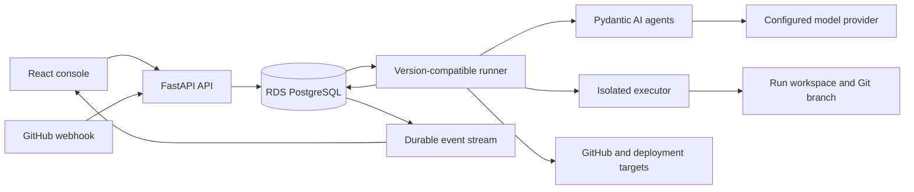

# PostgreSQL SDLC baseline

This application preserves the reference demo’s three SDLC workflows while moving orchestration into application code and PostgreSQL. It is a separate application for examining the work required to provide durability without Temporal. The baseline does not require a Temporal client, worker, server, namespace, or Cloud account.

The reference is [temporal-demo-agentic-sdlc at `10967999`](https://github.com/temporal-sa/temporal-demo-agentic-sdlc/tree/10967999). Registry integration was reviewed against demo-registry revision `d56184f`. These revisions establish the comparison inputs; later source changes require a fresh compatibility review.

## Workflow behavior

The issue workflow plans a change, waits for human approval, runs coding lanes, reviews the result, waits at merge and production gates, and records staging and canary progress before promotion or compensation. Dependency repair and PR review retain their own entry points and outcomes. A workflow’s version is fixed when it starts; selecting another version applies to new runs.

Scripted mode exercises deterministic control flow and failure injection without making real provider or release calls. Live mode uses configured adapters and credentials. The console labels the mode, and exported run records retain it. Scripted output must never be presented as a measured provider cost, completed external deployment, or comparative durability result.

The storefront release demonstration uses stored repository commit pointers and simulated canary routing. It does not reconfigure an AWS load balancer or replace the deployed SDLC application. The demo registry manages deployment of the SDLC application itself. Keep those two uses of “deployment” distinct when presenting the result.

The runner creates a self-contained storefront bundle in the isolated executor and persists it in PostgreSQL. The browser receives an opaque-origin sandbox with scripts allowed, storage access denied and network connections disabled. Inlining modules, styles and local JSON avoids depending on SSO cookies in sandbox subrequests. The web process needs no GitHub write or model credentials, including when the sandbox repository is private.

## Durability contract

PostgreSQL is the source of truth for runs, stages, task attempts, approval messages, budgets, deadlines, and audit events. The API acknowledges work after its durable record commits. State changes and subsequent work are committed together; notifications only make discovery faster. A runner that restarts discovers pending work from the database.

Workers claim tasks in short transactions, release database locks before calling providers or executors, and renew time-limited leases while working. A newer claim receives a newer fencing token. A worker whose lease expired cannot commit a stale result over the new owner. A periodic reconciliation pass finds expired attempts and due timers. Waiting for a person or a canary deadline does not hold a database transaction open.

Completed checkpoints are reused. An interrupted attempt may run again if its effect completed before the checkpoint was saved. External effects therefore require their own operation identity, a lookup or status check, and conditional execution where the target supports it. When the target cannot establish whether an effect occurred, recovery must surface the uncertainty instead of asserting exactly-once execution. This limitation also matters for model billing: a response lost before its checkpoint can produce a second billable request.

The run’s durable budget must cover attempts across workers and retries. Record usage as measured or estimated, retain unknown outcomes, and prevent a restart from resetting the budget. Do not nest independent retry loops without calculating their combined maximum attempt count.

Workspace data must survive a pod’s disappearance or be reconstructible from a durable revision and artifacts. Separate each run and coding lane. Executor isolation is a property of the configured executor and its permissions; an application subprocess alone does not demonstrate a security boundary.

The console first fetches a run snapshot, then consumes server-sent events. Each event carries a durable offset. On reconnection the browser supplies `Last-Event-ID`, and it continues polling as a fallback. A live connection indicator describes transport freshness; it does not establish that a worker is healthy or a deployment succeeded.

## AWS and registry boundaries

The application is packaged and installed through the demo registry. Reuse the registry’s existing AWS cluster, ingress, identity and secret conventions rather than introducing a second application deployment path. Registry installation and removal manage the application resources described in its manifest.

RDS PostgreSQL is an external prerequisite in the same VPC. The reviewed registry contract does not provision durable databases. The deployment must receive a reachable database URL and credentials through the supported secret mechanism, run migrations before accepting work, and verify database readiness separately from API liveness. Removing the demo must not silently delete the database or its evidence.

`isolatedExecutor` and `awsIamRoleArn` are registry capabilities to use when supported by the deployed registry version. Their presence in a newer schema does not establish support in an older installed registry. Validate the actual manifest against the installed contract and record any compatibility prerequisite. Scope the application role to its own executor, artifact and integration resources; cluster permissions must not become general-purpose agent tool credentials.

Deploy compatible runner versions side by side while old runs remain active. A rollout is complete only when existing run versions still have a recovery path. Changing a state definition without migrating stored state or retaining its implementation can strand a long-running approval.

## Evidence and limits

The baseline implements an application-level recovery model. It does not attempt to reproduce Temporal’s whole platform, deterministic history replay, operational tooling or ecosystem. Compare the same user-visible workflow and failure outcomes, and separately count the persistence, reconciliation, versioning and operating code required by each implementation.

The relevant database primitives are documented in PostgreSQL’s [queue-oriented use of `SKIP LOCKED`](https://www.postgresql.org/docs/current/sql-select.html) and [transaction and advisory lock behavior](https://www.postgresql.org/docs/current/explicit-locking.html). AWS’s [transactional outbox guidance](https://docs.aws.amazon.com/prescriptive-guidance/latest/cloud-design-patterns/transactional-outbox.html) explains the database/event dual-write problem and the need for idempotent consumers. These sources support the design mechanisms; passing the comparison protocol requires application-specific evidence.
